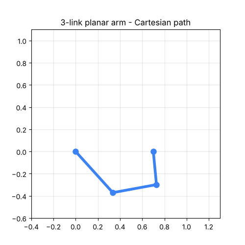

# Robot Arm Kinematics

A small, tested Python library for **forward kinematics, inverse kinematics and
trajectory planning** of planar robot arms, with a matplotlib simulator.




## Features

- Forward kinematics for any N-link planar arm (all joint positions + end-effector pose)
- Closed-form IK for 2-link arms (elbow-up / elbow-down)
- Numerical IK for N links using damped least squares (stable near singularities)
- Analytic Jacobian (verified against finite differences in tests)
- Joint limits
- Cubic joint-space trajectories and straight-line Cartesian paths
- Animated simulation

## Quick start

```bash
pip install -r requirements.txt
python examples/animate_arm.py        # watch a 3-link arm draw a square
pytest                                # run the test suite
```

```python
from robot_arm import PlanarArm

arm = PlanarArm([0.5, 0.4, 0.3])
q = arm.inverse([0.6, 0.4])     # joint angles (rad)
print(arm.forward(q))           # -> [0.6, 0.4, phi]
```

## The math

Forward kinematics sums each link along its cumulative angle:

```
x = Σ Lᵢ·cos(θ₁ + … + θᵢ)
y = Σ Lᵢ·sin(θ₁ + … + θᵢ)
```

Numerical IK iterates `Δq = Jᵀ (J Jᵀ + λ²I)⁻¹ e`, where `e` is the position
error and `λ` a damping factor that keeps steps bounded near singular poses.

## Roadmap

- [ ] 3D arms with Denavit–Hartenberg parameters
- [ ] Orientation control for the end-effector
- [ ] Serial bridge to drive a real servo arm (Arduino / ESP32)

## License

MIT © 2026 Akram Hssaine
